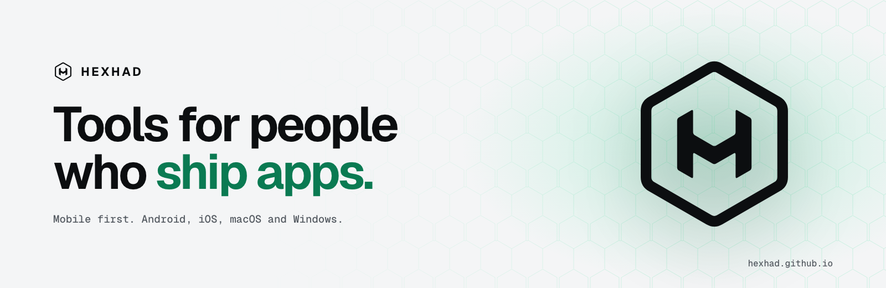

<a href="https://hexhad.github.io">
  <picture>
    <source media="(prefers-color-scheme: dark)" srcset="./docs/img/dark-banner.png" />
    <source media="(prefers-color-scheme: light)" srcset="./docs/img/light-banner.png" />
    
  </picture>
</a>

<p align="center">
  <a href="https://hexhad.github.io"><b>hexhad.github.io</b></a> ·
  <a href="https://hexhad.github.io/docs/brand.html">Brand</a> ·
  <a href="https://github.com/hexhad">GitHub</a> ·
  <a href="mailto:hashandharmapriya@gmail.com">Email</a>
</p>

# hexhad.github.io

Home of **HEXHAD**, an independent, mobile-first studio building apps and tools for Android, iOS, macOS and Windows.
HEXHAD is run by [Hashan Dharmapriya](https://linkedin.com/in/hashandharmapriya).

The site is a single static page with no build step, so GitHub Pages serves it straight from `master`.

## Products

| App | Platforms | Link |
| --- | --- | --- |
| **NotchPal**: Claude Code sessions in the MacBook notch | macOS | [website](https://notch-pal-nine.vercel.app/) |
| **NotchPal for Android**: approve Claude Code permission requests from your phone | Android | [Google Play](https://play.google.com/store/apps/details?id=com.hexhad.notchpal) |
| **BarQR**: QR and barcode maker and scanner | Android | [website](https://barqr-site.vercel.app/) · [Google Play](https://play.google.com/store/apps/details?id=com.hexhad.barqr) |
| **Droid Transfer**: Android file transfer for Mac | macOS | [website](https://droid-transfer-web.vercel.app/) |
| **MirrorMe**: a camera for iOS Simulators and Android emulators | macOS | [website](https://mirror-me-web.vercel.app/) |
| **Morse Code**: type a message and feel it as vibration | Android | [website](https://hexhad.github.io/morsecode-web/) · [Google Play](https://play.google.com/store/apps/details?id=com.hexhad.morsecode) |
| **Splice**: cut, join and polish audio, offline | Android | [website](https://splice-web-one.vercel.app/) |
| **DiskKeeper**: a Mac disk cleaner that knows your projects | macOS | [website](https://disk-keeper-web.vercel.app/) |
| **Wasthu dimensions** (වාස්තු මිනුම්): house sizes that follow the Wasthu rules | Web | [open the app](https://best-width-and-height-for-house-plan.vercel.app/) |

## Open source

- [`@hexhad/react-native-global-modal`](https://www.npmjs.com/package/@hexhad/react-native-global-modal): global alert queue for React Native
- [`react-native-nitro-otp-verify`](https://www.npmjs.com/package/react-native-nitro-otp-verify): SMS OTP reading on Android, built on Nitro Modules
- [`react-native-nitro-sms-user-consent`](https://www.npmjs.com/package/react-native-nitro-sms-user-consent): one-tap SMS OTP reading with the SMS User Consent API (no app hash), built on Nitro Modules
- [`@hexhad/react-utils`](https://www.npmjs.com/package/@hexhad/react-utils): typed React and React Native utilities

## Brand

The identity is documented at [`docs/brand.html`](https://hexhad.github.io/docs/brand.html).

- **Mark**: a hex cell around an H whose crossbar dips at 30°, so every cut runs parallel to a hexagon edge (`src/brand/hexhad-mark.svg`)
- **Colour**: Graphite neutrals (`#0A0B0D` to `#F4F5F6`) and one accent, Cell Mint `#43E0A0` (`#0A7A52` for small text on light)
- **Type**: Geist and Geist Mono
- **Motion**: the hero runs a noise-displaced WebGL shader gradient behind a honeycomb of the product icons; the closing mark is glowing liquid chrome

## Project layout

```
index.html              page markup, SEO and structured data
css/hexhad.css          styles and design tokens (dark and light)
js/main.js              theme toggle, reveals, active nav, copy buttons, lazy WebGL boot
js/liquid-scene.js      Three.js hero gradient + liquid-chrome mark (loaded on idle from jsDelivr)
src/brand/              mark, favicon, app icon
src/products/           product icons and screenshots
docs/brand.html         brand guidelines board
docs/banner.html        source for README banners, social card and PNG icons
docs/render-banners.sh  renders the banners, docs/img/og.png and the PNG icons
404.html                branded not-found page (GitHub Pages serves it automatically)
robots.txt, sitemap.xml, site.webmanifest   crawl + install metadata
```

## SEO

- Title, description, canonical, Open Graph and Twitter card tags in `index.html`
- JSON-LD `Organization` (HEXHAD), `Person` (founder) and a `SoftwareApplication` entry per product
- After changing content, bump `<lastmod>` in `sitemap.xml` and `dateModified` in the JSON-LD

## Run locally

```bash
python3 -m http.server 8765
# open http://localhost:8765
```

To regenerate the banners, social card and icons after editing `docs/banner.html`:

```bash
./docs/render-banners.sh
```

---

<p align="center"><sub>© HEXHAD · Made in Sri Lanka</sub></p>
